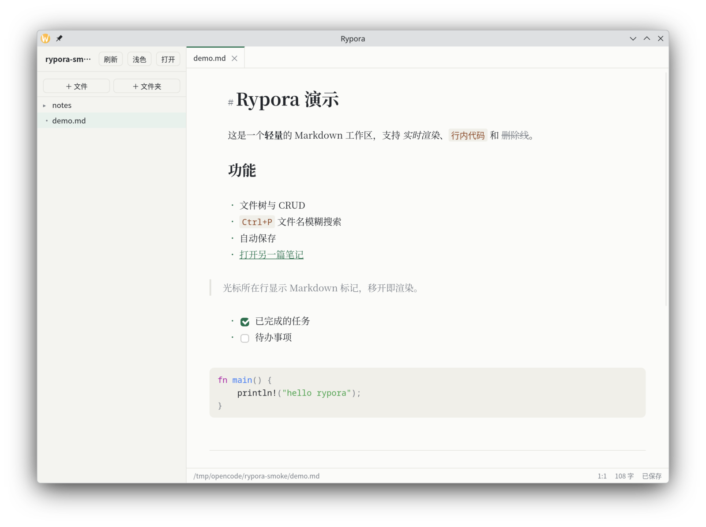

# Rypora

**A lightweight, local-first Markdown workspace.**

Rypora 是一个本地优先的 Markdown 工作区：打开一个文件夹就能写作，文件名和正文都能快速搜索，编辑区按 Typora 的方式实时渲染。

它只做三件事——管理文件夹、快速找到内容、安静地写作。不做图谱、插件、双链和同步。



## 功能

- **文件夹即工作区**：文件树、新建、重命名、删除、拖拽移动。
- **统一搜索**：`Ctrl+P` 同时搜文件名和正文，文件名结果优先，正文片段高亮，回车跳到命中行。
- **实时渲染**：标题、粗体/斜体、删除线、行内代码、代码块高亮、图片、链接、引用、列表、任务列表、分割线。
- **源码与排版共存**：光标所在行显示 Markdown 源码，移开即渲染。
- **自动保存**：400ms 去抖、原子写入、保留 LF / CRLF。
- **标签页与会话恢复**：重启后恢复工作区、标签和光标位置。
- **外部变更提示**：磁盘上的修改/删除不会静默覆盖你的内容。
- **后台全文索引**：Tantivy + jieba，批量提交，不阻塞保存；索引异常时可一键重建。
- **主题**：亮色 / 暗色 / 跟随系统。

## 下载

从 [Releases](https://github.com/lovelock/rypora/releases) 获取对应平台的安装包：

| 平台 | 产物 |
|---|---|
| Linux x86_64 | `.AppImage` / `.deb` / `.rpm` |
| Arch Linux x86_64 | `.pkg.tar.zst` |
| Windows x86_64 | NSIS `.exe` / `.msi` |
| macOS | `.dmg`（Apple Silicon / Intel） |

Arch Linux 安装：

```bash
sudo pacman -U rypora-0.3.0-1-x86_64.pkg.tar.zst
```

构建产物未做代码签名。macOS 首次打开需要右键 → “打开”；Windows 可能弹出 SmartScreen 提示。

## 使用

1. 启动后点击“打开”，选择一个存放 Markdown 文件的文件夹。
2. 按 `Ctrl+P`，输入文件名或正文里的词。
3. `↑` / `↓` 选择结果，`Enter` 打开；正文命中会定位到第一处匹配。
4. 搜索面板底部的“重建全文索引”可以在索引异常时手动恢复。

### 快捷键

> macOS 用 `Cmd`，Windows / Linux 用 `Ctrl`。

| 快捷键 | 功能 |
|---|---|
| `Cmd/Ctrl+N` | 新建文件 |
| `Cmd/Ctrl+Shift+N` | 新建文件夹 |
| `Cmd/Ctrl+O` | 打开文件夹 |
| `Cmd/Ctrl+P` | 文件名 + 正文搜索 |
| `Cmd/Ctrl+S` | 立即保存 |
| `Cmd/Ctrl+W` | 关闭当前标签 |
| `Cmd/Ctrl+Shift+P` | 打印 / 另存为 PDF |
| `Ctrl+Tab` | 下一个标签 |
| `Cmd/Ctrl+B` / `Cmd/Ctrl+I` | 粗体 / 斜体 |
| `Cmd/Ctrl+Shift+X` | 删除线 |
| `Cmd/Ctrl+E` | 行内代码 |
| `F2` | 重命名当前选中项 |

### 打印 / 导出 PDF

按 `Cmd/Ctrl+Shift+P`，或点状态栏右侧的「打印」。会打开系统打印对话框：

- 打印到打印机：直接选择打印机。
- 导出 PDF：在对话框里选「另存为 PDF」（macOS / Linux）或「Microsoft Print to PDF」（Windows）。

打印内容是渲染后的 Markdown（标题、列表、表格、代码高亮、图片），不是编辑器当前视口。

## 从源码运行

需要 Rust 1.77+ 和 Node.js 20+。

Linux 还需要：

```bash
# Debian / Ubuntu
sudo apt install libwebkit2gtk-4.1-dev libayatana-appindicator3-dev \
  librsvg2-dev patchelf

# Arch Linux
sudo pacman -S --needed webkit2gtk-4.1 gtk3 libsoup3 base-devel
```

```bash
git clone https://github.com/lovelock/rypora.git
cd rypora
npm install
npm run tauri dev
```

打包：

```bash
npm run tauri build
```

Linux 下会生成 `.deb`、`.rpm` 和 `.AppImage`，位置在 `src-tauri/target/release/bundle/`。

Arch 的 pacman 包：

```bash
VERSION="$(node -p "require('./src-tauri/tauri.conf.json').version")"
bash packaging/arch/build-pkg.sh "$VERSION" src-tauri/target/release/rypora
```

## 测试

```bash
cargo test --manifest-path src-tauri/Cargo.toml
npx vitest run
npm run check
npm run build
```

## 架构

| 层 | 技术 | 职责 |
|---|---|---|
| 桌面壳 | Tauri 2 | 窗口、文件对话框、系统打开/托盘入口 |
| 后端 | Rust | 目录扫描、文件 CRUD、原子写入、文件监听、文件名索引、Tantivy 全文索引、会话配置 |
| UI | Svelte 5 + TypeScript | 文件树、搜索面板、标签、状态栏 |
| 编辑器 | CodeMirror 6 | 文档编辑；Lezer Markdown 语法树 + 装饰实现实时渲染 |
| 全文搜索 | Tantivy + jieba | BM25 排序、中文分词、片段高亮、后台批量索引 |

主要的 Rust 模块在 `src-tauri/src/`，前端在 `src/lib/`，桌面配置在 `src-tauri/tauri.conf.json`。

## 贡献

欢迎提交 issue 和 PR。提交前请确保上面的测试全部通过，并尽量让改动保持聚焦。

项目目前处于 `0.1` 阶段，接口、索引格式和文件行为仍可能调整。
